# ReviewSense AI — AI-Powered Customer Review Analysis

ReviewSense AI is a web application that analyzes customer reviews using Google's Gemini AI and presents the results through an interactive dashboard. It helps users understand customer sentiment, explore recurring themes, and generate actionable insights.

This project was developed as part of the **DevOps and Kubernetes ISE-II** practical assignment, demonstrating web development, version control, automated testing, Jenkins integration, and containerization.

**Repository:** [ReviewSense AI on GitHub](https://github.com/APpppurv03/reviewsense-ai)

---

## 1. Project Overview

ReviewSense AI helps users analyze customer feedback without manually examining every review. The application provides an organized workspace for reviewing analysis results and using them for reporting and decision-making.

### Objectives

- Build a functional AI-powered review analysis website.
- Display analysis results in a clear dashboard.
- Improve usability with search, CSV export, history, copy summary, and print report features.
- Maintain a structured Git and GitHub commit history.
- Integrate Jenkins for Continuous Integration.
- Use automated testing to verify application behavior.

## 2. Features

- AI-powered customer review analysis.
- Sentiment classification and analysis dashboard.
- Keyword search for classified reviews.
- CSV export of classified review data.
- Recent analysis history.
- Copyable executive summary.
- Print-friendly analysis report.
- Automated testing using pytest.
- Jenkins CI pipeline integration.
- Container execution evidence.

## 3. Technology Stack

| Technology        | Purpose                                |
| ----------------- | -------------------------------------- |
| Python            | Backend application logic              |
| Flask             | Web framework                          |
| HTML5             | Page structure                         |
| CSS3              | Styling and layout                     |
| JavaScript        | Interactive dashboard                  |
| Google Gemini API | AI-powered review analysis             |
| Git and GitHub    | Version control and repository hosting |
| pytest            | Automated testing                      |
| Jenkins           | Continuous Integration                 |
| Docker            | Containerization                       |

## 4. Application Screenshots

### 4.1 Application Interface

<p align="center">
  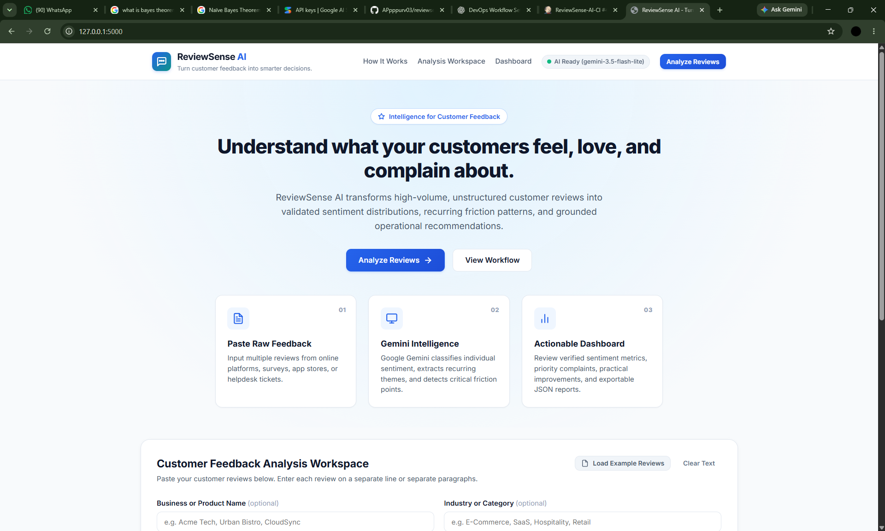
</p>

<p align="center"><em>Figure 1: Main application interface.</em></p>

### 4.2 Working Analysis

<p align="center">
  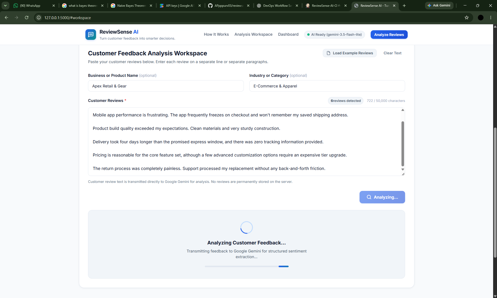
</p>

<p align="center"><em>Figure 2: Review analysis workflow.</em></p>

### 4.3 Analysis Details

<p align="center">
  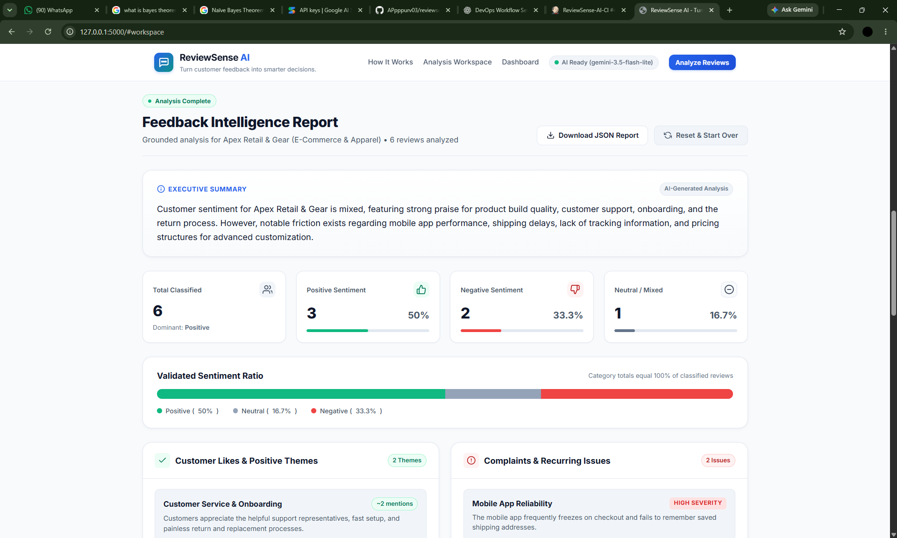
</p>

<p align="center"><em>Figure 3: Analysis results and details.</em></p>

## 5. Website Improvements

The following five improvements were implemented in separate commits.

### 5.1 Keyword Search for Classified Reviews

**Commit:** `118768c` — `Add keyword search for classified reviews`

Allows users to search classified reviews and find relevant results more efficiently.

<p align="center">
  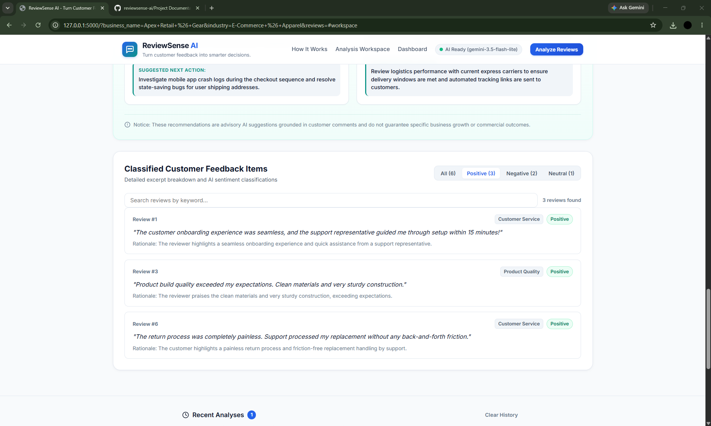
</p>

<p align="center"><em>Figure 4: Keyword search and filtered review results.</em></p>

### 5.2 CSV Export

**Commit:** `ec83ec2` — `Add CSV export for classified reviews`

Allows users to download classified review information in CSV format for further examination and reporting.

<p align="center">
  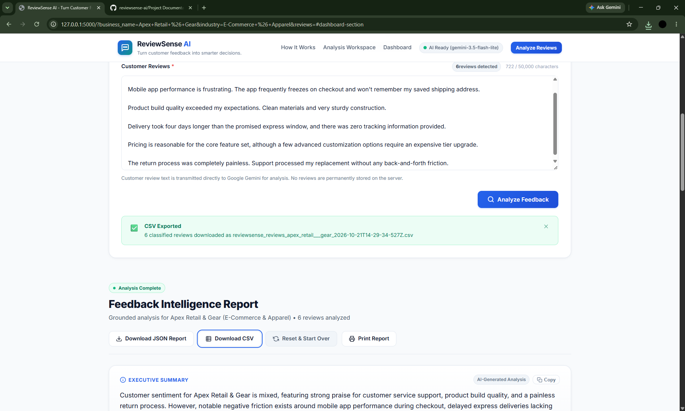
</p>

<p align="center"><em>Figure 5: CSV export functionality.</em></p>

### 5.3 Recent Analysis History

**Commit:** `dc83592` — `Add recent analysis history`

Provides access to recent analysis summaries through browser-side history storage.

<p align="center">
  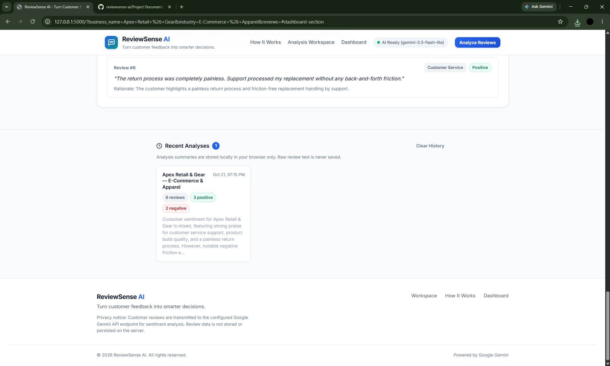
</p>

<p align="center"><em>Figure 6: Recent analysis history panel.</em></p>

### 5.4 Copy Analysis Summary

**Commit:** `6d0037d` — `Add copy action for analysis summary`

Adds a convenient way to copy the generated analysis summary for reuse in reports and notes.

<p align="center">
  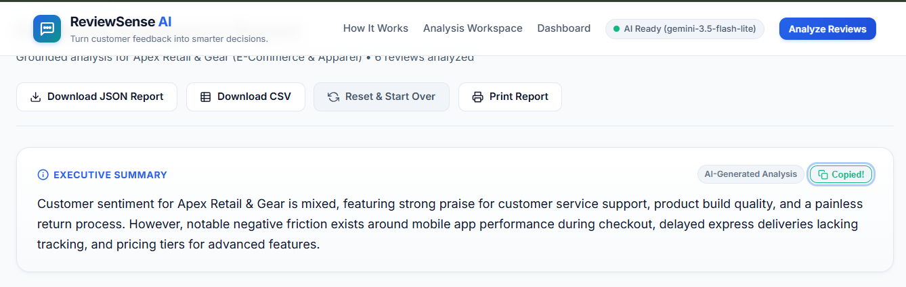
</p>

<p align="center"><em>Figure 7: Copy summary functionality.</em></p>

### 5.5 Print-Friendly Report

**Commit:** `0555542` — `Add print-friendly report view and dashboard action button`

Provides a print-friendly layout so the analysis can be printed or saved as a PDF through the browser.

<p align="center">
  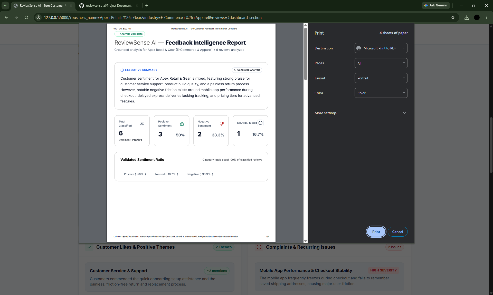
</p>

<p align="center"><em>Figure 8: Print-friendly report functionality.</em></p>

## 6. Git and GitHub Version Control

Git was used to maintain the source-code history, and GitHub hosts the remote repository.

**Repository:** [APpppurv03/reviewsense-ai](https://github.com/APpppurv03/reviewsense-ai)

### Repository Evidence

<p align="center">
  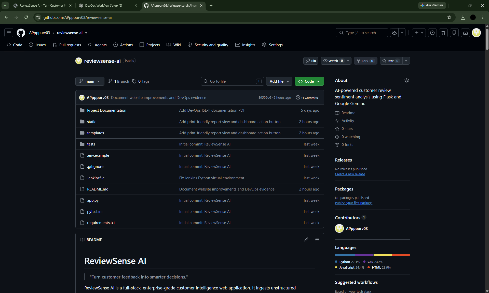
</p>

<p align="center"><em>Figure 9: Project repository on GitHub.</em></p>

### Version-Control Workflow

The workflow uses Git to track changes, create separate commits for individual improvements, and push the changes to GitHub.

```bash
git status
git log --oneline
git diff
git add <changed-files>
git commit -m "Describe the change"
git push origin main
```

### Commit History Evidence

<p align="center">
  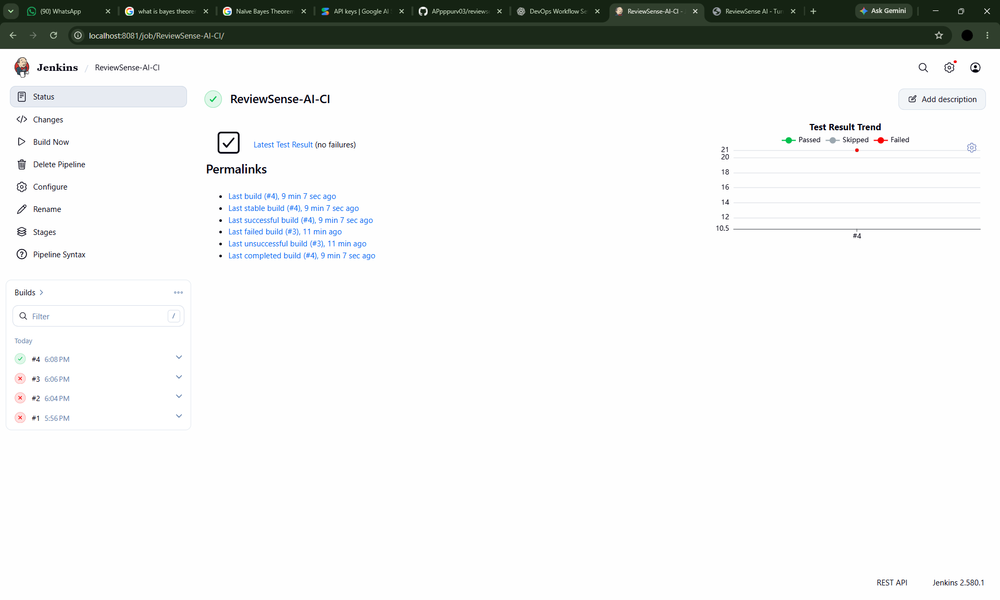
</p>

<p align="center"><em>Figure 10: Version-control evidence.</em></p>

<p align="center">
  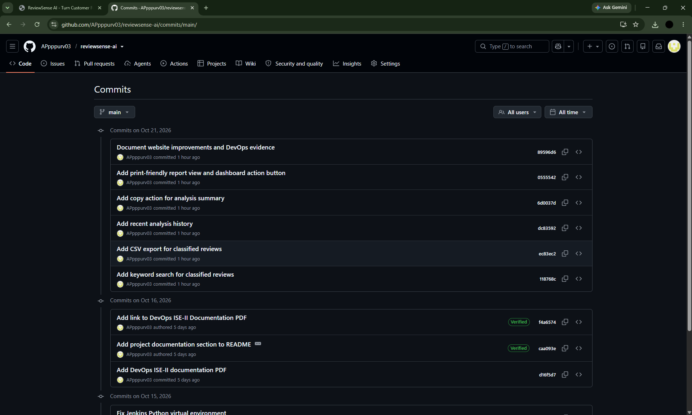
</p>

<p align="center"><em>Figure 11: GitHub commit history.</em></p>

The five website improvements are separate from the documentation commit:

- `89596d6` — `Document website improvements and DevOps evidence`

## 7. Jenkins Continuous Integration

Jenkins is used to organize the project's Continuous Integration workflow.

**Existing Jenkins job:** [ReviewSense-AI-CI](http://localhost:8081/job/ReviewSense-AI-CI/)

This address is local to the machine running Jenkins.

### CI Workflow

1. Check out the project source.
2. Prepare the Python environment.
3. Install project dependencies.
4. Execute the configured automated test suite.
5. Inspect the build console output and test results.

### Jenkins Job Evidence

<p align="center">
  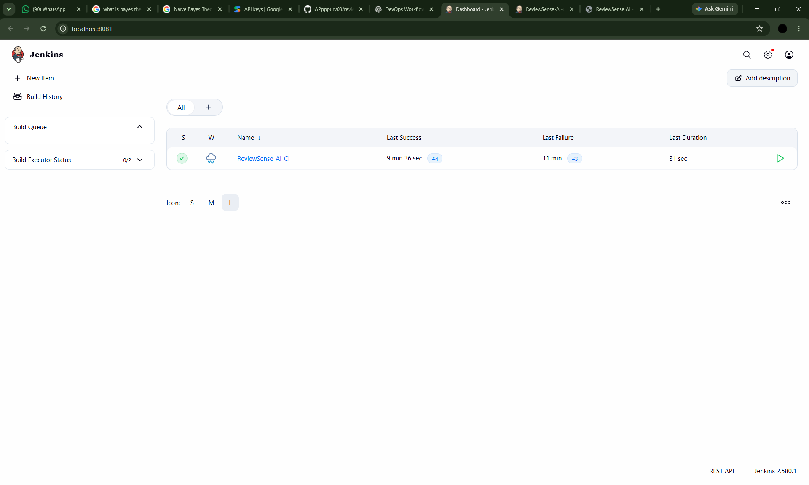
</p>

<p align="center"><em>Figure 12: Jenkins job evidence.</em></p>

### CI Pipeline Execution

<p align="center">
  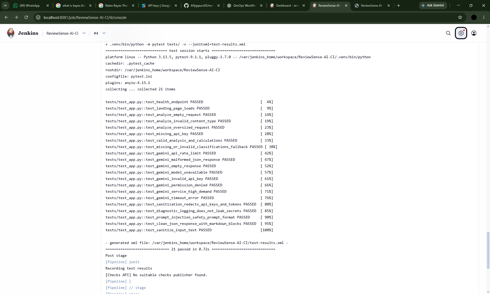
</p>

<p align="center"><em>Figure 13: CI pipeline execution evidence.</em></p>

The screenshots document the Jenkins configuration and execution. A successful build should only be claimed when confirmed by the actual build output.

## 8. Automated Testing

The project uses pytest for automated verification of backend routes, input validation, analysis behavior, error handling, and related application logic.

Run the tests using:

```bash
python -m pytest tests/ -v
```

A previously recorded local test run reported **21 passed**. Run the command again to confirm the current code's result before final submission.

<p align="center">
  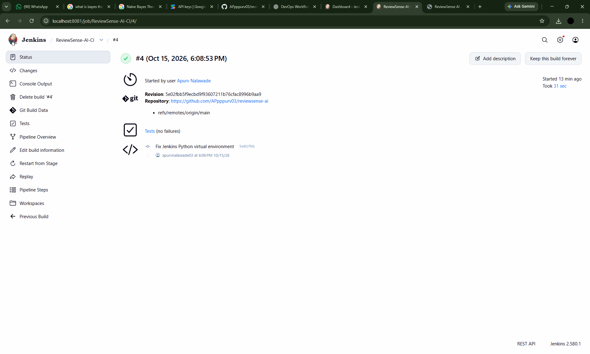
</p>

<p align="center"><em>Figure 14: Automated testing evidence.</em></p>

## 9. Containerization

The project documentation includes evidence of container execution as part of the DevOps workflow.

<p align="center">
  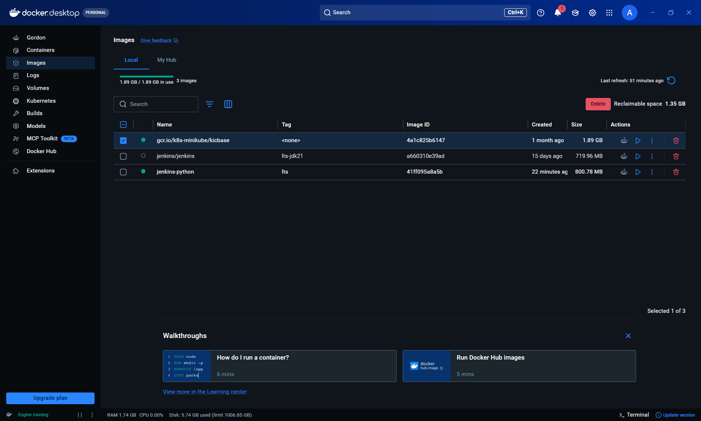
</p>

<p align="center"><em>Figure 15: Container execution evidence.</em></p>

## 10. Installation and Setup

### Prerequisites

- Python 3.x
- Git
- pip
- A web browser
- A Gemini API key for live AI analysis

### Step 1: Clone the Repository

```bash
git clone https://github.com/APpppurv03/reviewsense-ai.git
cd reviewsense-ai
```

### Step 2: Create a Virtual Environment

On Windows:

```bat
python -m venv .venv
.venv\Scripts\activate
```

### Step 3: Install Dependencies

```bash
pip install -r requirements.txt
```

### Step 4: Configure Environment Variables

Create a local `.env` file in the project root and set the API key using the variable name expected by the application.

For example:

```text
GEMINI_API_KEY=your_actual_api_key_here
```

Never commit API keys or credentials to GitHub.

### Step 5: Run the Application

```bash
python app.py
```

Open the local URL displayed by Flask. The existing development environment uses:

`http://127.0.0.1:5000`

### Step 6: Run Automated Tests

```bash
python -m pytest tests/ -v
```

## 11. Conclusion

ReviewSense AI demonstrates how AI-powered customer review analysis can be combined with practical website improvements and DevOps practices. The project includes separate feature commits, GitHub-based version control, automated testing, Jenkins integration, and supporting documentation.

The README provides an overview of the application, setup instructions, development history, and visual evidence of the project's features and DevOps workflow.
